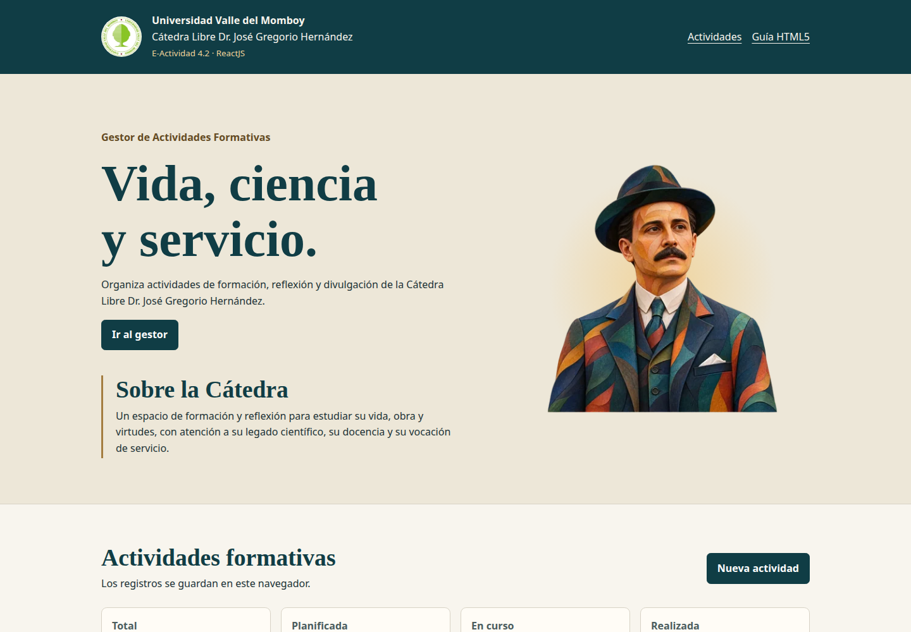
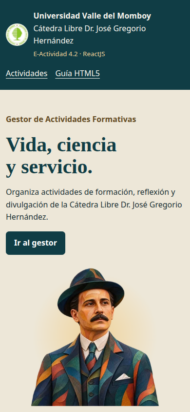
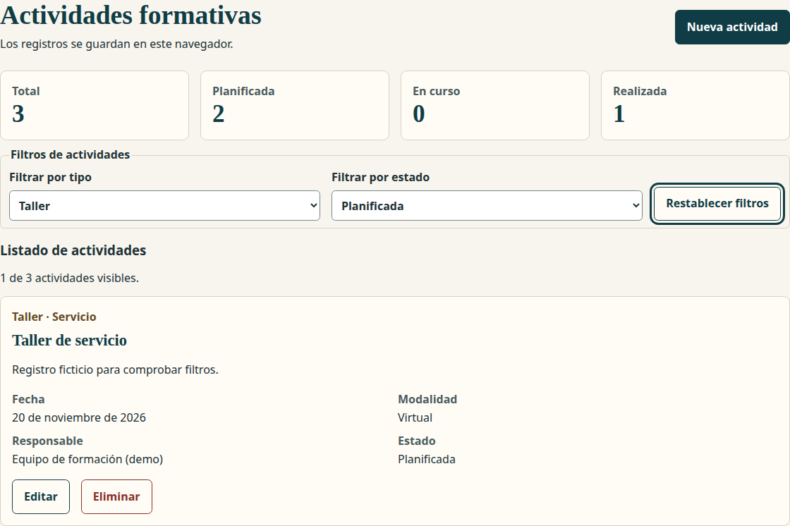
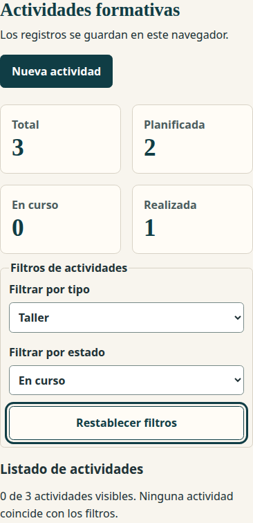
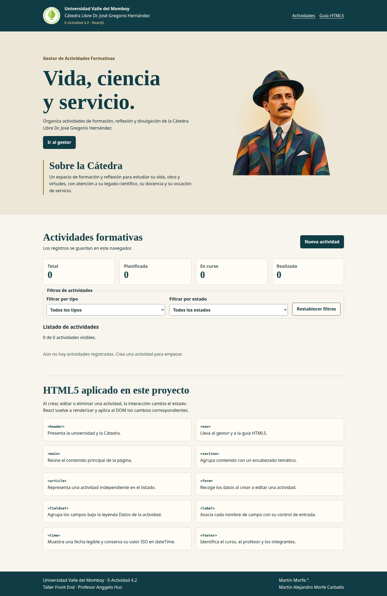
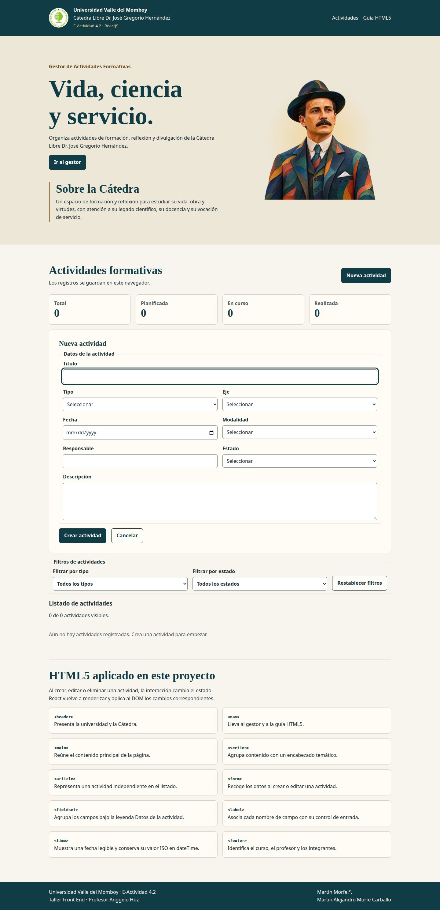
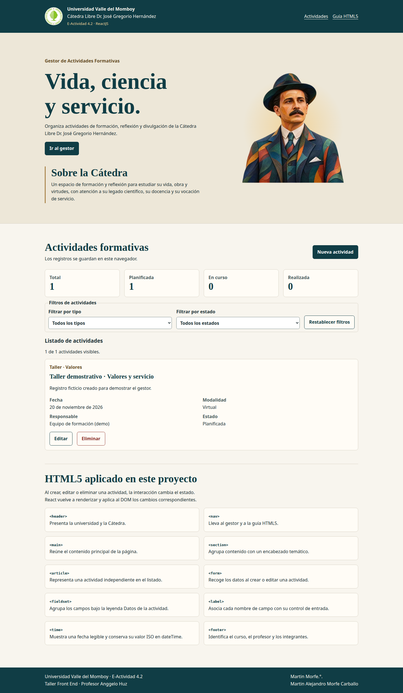
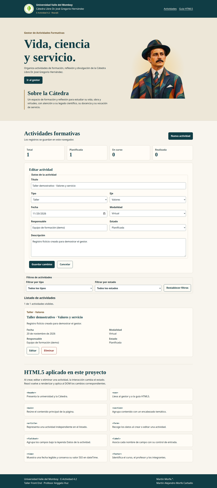
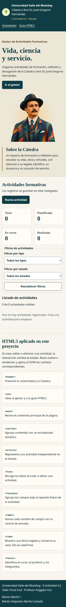
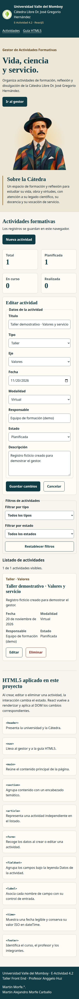

# Cátedra Libre Dr. José Gregorio Hernández

**Gestor de Actividades Formativas** · Universidad Valle del Momboy

E-Actividad 4.2 de FrontEndIVIVFI2026C · Taller Front End · profesor Anggelo Huz · ponderación 15 %.

**Integrantes:** Martin Morfe.°. y Martin Alejandro Morfe Carballo.

## Aplicación

El gestor permite crear, consultar, editar y eliminar actividades de formación, reflexión y divulgación. Cada actividad tiene título, tipo, eje, fecha, modalidad, responsable, descripción y estado. El formulario valida sus datos y la baja pide confirmación. Los indicadores se calculan a partir de la lista.

React renderiza la interfaz declarativamente al cambiar el estado. `localStorage` conserva los cambios al recargar. El diseño combina HTML5 semántico, una guía dentro de la aplicación, CSS propio, Grid, Flexbox y media queries. El formulario emplea etiquetas, mensajes de validación y foco inicial en el editor.

La lista empieza vacía y el almacenamiento pertenece al origen y perfil del navegador. Los filtros por tipo y estado se pueden combinar o restablecer. El listado anuncia cuántas actividades coinciden y dirige el foco a un destino disponible después de guardar, cancelar o eliminar. Esta contribución corresponde a Martin Alejandro Morfe Carballo.

## Instalación y comprobaciones

Usar Node.js 22.12+.

```sh
npm ci
npm run dev
npm test
npm run lint
npm run build
npm run preview
```

Vite indica la URL local con el prefijo `/catedra-jgh-react-uvm-e4-2/`. Las 6 pruebas unitarias aprobadas abarcan reducer, validación y persistencia. Para repetir las pruebas de CRUD, filtros, teclado y foco en Chromium, instalar el navegador con `npx playwright install chromium`, levantar la vista previa y ejecutar `npm run qa:browser`.

- [Arquitectura y flujo](docs/ARQUITECTURA.md)
- [Pliego canónico](docs/PLIEGO_CANONICO.md)
- [Matriz de cumplimiento](docs/CUMPLIMIENTO.md)
- [Ejecuciones de validación](docs/VALIDACION.md)
- [Auditoría técnica](docs/FINAL_AUDIT.md)

## Entregables

- Aplicación publicada y verificada con Chromium en escritorio, tableta y móvil. [GitHub Pages](https://mmorfe-engineer.github.io/catedra-jgh-react-uvm-e4-2/)
- Presentación académica de 12 láminas en PowerPoint. [Descargar presentación](docs/presentacion/uvm-e-actividad-4-2.pptx)
- Historial de la segunda contribución. [PR de filtros y accesibilidad](https://github.com/mmorfe-engineer/catedra-jgh-react-uvm-e4-2/pull/1) · [PR de validación en producción](https://github.com/mmorfe-engineer/catedra-jgh-react-uvm-e4-2/pull/2)
- [Archivo nativo de Figma](https://www.figma.com/design/tuAuL4Td1Sd9Xx8EvV8Hg8). [Paquete de referencia](docs/figma/README.md) · [Especificación](docs/FIGMA_SPEC.md)
- **Video explicativo pendiente.** [Guion](docs/VIDEO_SCRIPT.md)

## Capturas de la interfaz




[Portada en escritorio](docs/assets/desktop-institucional.png) · [Portada en tableta](docs/assets/tablet-institucional.png) · [Portada en móvil](docs/assets/movil-institucional.png)




[Escritorio](docs/assets/desktop.png) · [Página completa en tableta](docs/assets/tablet-principal.png) · [Listado en tableta](docs/assets/tablet.png) · [Móvil](docs/assets/movil.png) · [Editor móvil](docs/assets/movil-editor.png)

## Galería de referencias para Figma

| Frame | Referencia |
| --- | --- |
| Principal | <a href="docs/figma/01-desktop-principal.png"></a> |
| Nueva actividad | <a href="docs/figma/02-desktop-nueva-actividad.png"></a> |
| Actividades | <a href="docs/figma/03-desktop-actividades.png"></a> |
| Edición | <a href="docs/figma/04-desktop-edicion.png"></a> |
| Móvil · Principal | <a href="docs/figma/05-mobile-principal.png"></a> |
| Móvil · Formulario y listado | <a href="docs/figma/06-mobile-formulario-listado.png"></a> |

[Sistema de diseño](docs/figma/07-sistema-de-diseno.svg) · [Dimensiones e instrucciones de incorporación](docs/figma/README.md)

## Fuentes

- Pliego del profesor, reproducido en los requisitos del proyecto. [Pliego canónico](docs/PLIEGO_CANONICO.md)
- Contexto institucional de la Universidad Valle del Momboy. [Cátedra y diplomado JGH](https://uvm.edu.ve/uvm-abre-sus-puertas-al-diplomado-jose-gregorio-hernandez-un-modelo-de-virtudes-para-la-venezuela-posible/) · [Dirección de Formación General](https://uvm.edu.ve/direccion-de-formacion-general/)
